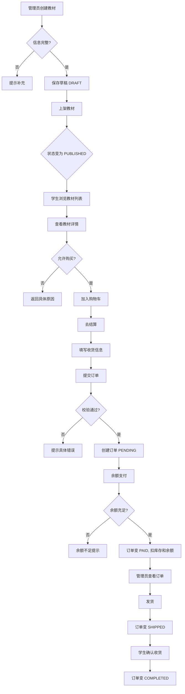

**核心流程（Mermaid）：**

**流程节点说明：**

| 节点 | 角色 | 动作 | 系统响应 | 关联需求 |
|------|------|------|---------|---------|
| A | 管理员 | 创建教材 | 校验字段 | REQ-006 |
| D | 系统 | 保存草稿 | 状态 DRAFT | REQ-006 |
| E | 管理员 | 上架 | 校验完整 | REQ-006 |
| G | 学生 | 浏览列表 | 显示已上架 | REQ-001 |
| H | 学生 | 查看详情 | 显示详情 | REQ-002 |
| K | 学生 | 加入购物车 | 新增 Cart 记录 | REQ-003 |
| N | 学生 | 提交订单 | 校验库存/余额 | REQ-004 |
| Q | 系统 | 创建订单 | 状态 PENDING | REQ-004 |
| R | 学生 | 余额支付 | 扣款 | REQ-009 |
| U | 系统 | 更新订单 | 状态 PAID | REQ-009 |
| V | 管理员 | 查看订单 | 显示列表 | REQ-007 |
| W | 管理员 | 发货 | 状态 SHIPPED | REQ-008 |
| Y | 学生 | 确认收货 | 状态 COMPLETED | REQ-005 |

**预期结果与人工检查：**
- 流程有明确起点、终点和至少一个判断分支。
- 每个系统动作都产生页面提示或数据变化。
- 流程节点与 MVP 功能能够对应。

**实际结果：**
- ✅ 完整流程图已绘制。
- ✅ 13 个流程节点已说明。
- ✅ 每个节点关联需求编号。

**常见错误与定位方法：**
- 流程只有页面跳转没有业务判断时，应补充系统责任。
- 箭头交叉过多时拆成发布子流程和购买子流程。

---