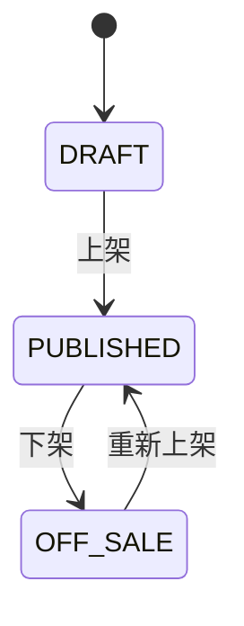
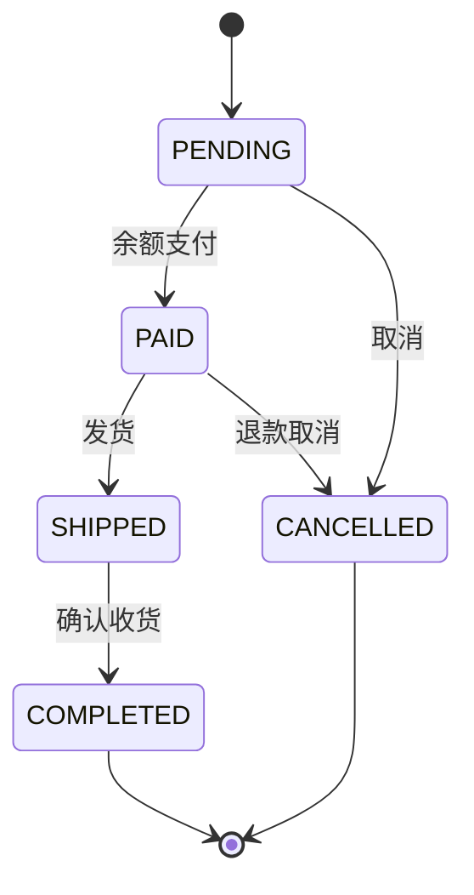

**业务对象状态表：**

| 对象 | 状态 | 允许操作 | 禁止操作 | 触发条件 |
|------|------|---------|---------|---------|
| Book | DRAFT | 编辑、上架、删除 | 被浏览、被购买 | 管理员创建 |
| Book | PUBLISHED | 编辑、下架、被浏览、被购买 | 删除 | 管理员上架 |
| Book | OFF_SALE | 编辑、重新上架 | 被浏览、被购买 | 管理员下架 |
| Order | PENDING | 支付、取消 | 发货、收货 | 学生提交订单 |
| Order | PAID | 发货、取消（退款） | 支付、收货 | 学生支付 |
| Order | SHIPPED | 确认收货 | 支付、发货 | 管理员发货 |
| Order | COMPLETED | 评价（可选） | 其他操作 | 学生确认收货 |
| Order | CANCELLED | 查看 | 其他操作 | 取消订单 |

**Book 状态机（Mermaid）：**

**Order 状态机（Mermaid）：**

**预期结果与人工检查：**
- 订单记录关联一个用户和一个教材。
- Book 状态值在需求、原型和后续代码中保持一致。
- 不存在从 CANCELLED 直接恢复到 DRAFT 等未定义变化。

**实际结果：**
- ✅ 3 个核心对象已识别。
- ✅ 2 个状态机（Book 和 Order）已描述。
- ✅ 状态允许/禁止操作已明确。

**常见错误与定位方法：**
- 把页面临时显示字段误当数据库字段时，应标记为派生字段。
- 状态名称中英文混用时建立枚举映射并统一保存值。

---
